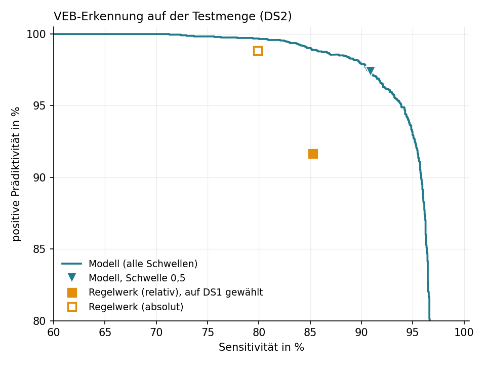

# ecg-arrhythmia-detection


Detection of ventricular ectopic beats (VEB) on the MIT-BIH Arrhythmia Database. Three detectors are
compared on an inter-patient split: a rule set, a random forest on 34 hand-built features and a small 1D CNN
on raw beat windows. The metric I care about is false alarms per hour at a given sensitivity.

## Result

Test set DS2: 22 patients, 11 hours of ECG, 49,685 beats, 3,220 of them VEB. Every threshold and model was
fit on the 22 training patients (DS1) only.

| Detector | Sensitivity | Positive predictivity | False alarms / hour | Missed VEB |
| --- | --- | --- | --- | --- |
| Rules (premature and wide) | 85.3 % | 91.7 % | 22.7 | 474 |
| Random forest, threshold 0.5 | 90.9 % | 97.4 % | 7.2 | 294 |
| 1D CNN, threshold from validation, mean of 3 seeds | 96.6 % | 51.2 % | 269 | 110 |

The random forest catches more VEB than the rules and raises 68 % fewer false alarms (79 instead of 250).
Tuned to the rules' sensitivity, it drops to 31 false alarms.

The CNN finds almost every VEB, but every second alarm is wrong.



## CNN vs. random forest

Two test patients cause most of its false alarms: record 117 (1,127 normal beats flagged, the patient has
no VEB at all) and record 111 (748 beats with left bundle branch block). Their normal beats look
"ventricular" compared with the training patients. The random forest raises 2 false alarms on the same two
records, because its features are relative to the patient: QRS width against the last 30 beats, amplitude
against the patient's own reference.

Giving the CNN a second channel with the deviation from the patient's median beat lifts precision from 40 %
to 51 %, no further. Its score distribution also shifts from patient to patient, so a threshold chosen on
DS1 does not hold on DS2. Validation loss rises from epoch 4 to 6 while training loss keeps falling. A
bigger network would fit the training patients better but would not fix the shift between patients. The
inter-patient literature reports the same: with 22 training patients, patient-relative features do better
than end-to-end learning without per-patient normalisation.

## Background

ICU monitors raise a lot of false alarms. Drew et al. (2014) reviewed 12,671 arrhythmia alarms from five
ICUs and found 88.8 % of them false, wide QRS complexes from bundle branch block among the causes. Record 111 shows the same
problem here: a wide QRS alone is not a reliable criterion.

This repo works one level below the alarm, on single beats. Ventricular tachycardia is a run of ventricular
beats, so a beat detector with few false positives is the building block for any alarm logic above it.

## Method

- Data: 48 half-hour two-lead recordings at 360 Hz, every beat annotated by at least two cardiologists.
  Lead MLII only.
- Split: DS1/DS2 after de Chazal et al. (2004), no patient in both sets. A random split of beats would
  let the model memorise patients and inflate every number. The four paced records are excluded (AAMI).
- Features: RR intervals before and after the beat, also relative to the local rhythm; QRS width
  absolute and relative to the last 30 beats; beat shape from 250 ms before to 400 ms after the R peak as
  26 averages.
- Models: rule thresholds from a grid search on DS1; random forest with 200 trees, class-weighted, no
  tuning; CNN with 7,089 parameters in JAX, CPU only, epoch and threshold chosen on five held-out DS1
  patients.
- QRS detection is checked separately: NeuroKit2 finds 98.8 % of beats at 98.1 % positive
  predictivity across all 44 records, with clear patient-specific failures (record 113, record 207).

## Run it

Python 3.11+. The first run downloads about 90 MB from PhysioNet.

```bash
git clone https://github.com/jonathankuhn11-spec/ecg-arrhythmia-detection.git && cd ecg-arrhythmia-detection
python -m venv .venv && source .venv/bin/activate
pip install -r requirements.txt
python run_pipeline.py --download   # all numbers above, about a minute
python run_cnn.py                   # CNN comparison, about 8 minutes on a CPU
python -m pytest -q                 # tests on synthetic signals, no download
```

Seeds and package versions are pinned. Full report: [`results/report.md`](results/report.md), raw values:
[`results/metrics.json`](results/metrics.json).

## Limits

- Beats, not alarms. MIT-BIH is ambulatory ECG, not ICU monitor data. Whether fewer false beats mean fewer
  false alarms at the bedside needs a dataset like VTaC.
- Classification uses the annotated beat positions, as is usual in the literature. Detection errors do not
  yet flow into the VEB numbers.
- 22 test patients, one split, no confidence intervals. Records 201 and 202 come from the same person.
- The equal-sensitivity comparison reads the random forest threshold off DS2. It describes separability,
  not a pre-set operating point. The CNN threshold comes from DS1 validation only.
- Not real-time and not a medical device.

## Next

1. End-to-end run on detected instead of annotated R peaks
2. Per-patient score normalisation for the CNN, and a hybrid: CNN embedding plus relative features
3. Bootstrap confidence intervals over records
4. Move to alarm level with PhysioNet/CinC 2015 and VTaC

The German version with per-record analysis, all figures and full references is in
[`docs/README.de.md`](docs/README.de.md).

Code under MIT. The ECG data is not in the repo; it is downloaded from PhysioNet under its own license.
